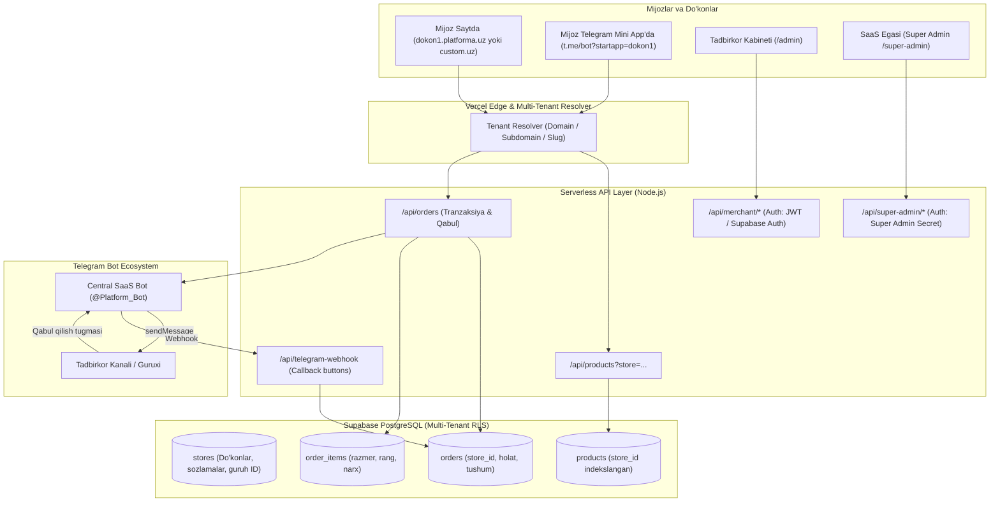

# MULTI-TENANT E-COMMERCE SAAS PLATFORM
## MAHSULOTNING TO‘LIQ PRD (PRODUCT REQUIREMENTS DOCUMENT) VA TEXNIK VAZIFASI (TZ)

> **Hujjat versiyasi:** 1.0.0-PRO  
> **Muallif:** Senior Software Architect & Full-Stack Engineer  
> **Loyiha nomi:** Universal Multi-Tenant E-Commerce SaaS Platform (Web + Telegram Mini App + Bot)  
> **Maqsadli auditoriya:** Kichik va o‘rta tadbirkorlar (20 dan 1000+ gacha mustaqil do‘konlar)  
> **Hujjat maqsadi:** Mavjud KIDS-SHOP kod bazasini to‘liq ko‘p do‘konli (Multi-Tenant) SaaS platformasiga aylantirish uchun yagona arxitektura va texnik standartlarni belgilash.

---

## 1. LOYIHA KONSEPSIYASI VA BIZNES TALABLARI

### 1.1. Asosiy maqsad
O‘zbekistondagi kiyim-kechak, poyabzal, o‘yinchoq va boshqa tovarlar sotuvchi kichik tadbirkorlarga bir necha daqiqa ichida o‘zlarining shaxsiy brendiga ega bo‘lgan quyidagi 4 ta vositani bitta tizimda taqdim etish:
1. **Mustaqil Veb-sayt:** Bepul subdomen (`dokon.platforma.uz`) yoki shaxsiy domen (`dokon.uz`) orqali ishlovchi zamonaviy internet-do‘kon.
2. **Telegram Mini App:** Xuddi shu do‘konning Telegram ichida bir zumda ochiluvchi mobil ilovasi.
3. **Telegram Buyurtma Xabarnomasi:** Sayt yoki Mini App’dan tushgan buyurtmalarni tadbirkorning o‘z Telegram kanali yoki operatorlar guruhiga interaktiv hisobot sifatida yetkazish.
4. **Shaxsiy Boshqaruv Kabineti (Merchant Dashboard):** Tovarlar, narxlar, ranglar, razmerlar, buyurtma holatlari va savdo tushumini mustaqil boshqarish.

---

## 2. ARXITEKTURA VA TIZIM DIZAYNI

### 2.1. Tizimning umumiy arxitekturasi (Decoupled & Multi-Tenant)



### 2.2. Frontendni istalgan paytda almashtirish imkoniyati (Decoupled / Headless Kafolati)

> [!IMPORTANT]
> **Arxitekturaviy Tamoyil (Decoupled Architecture):**
> Backend (Baza, API, Telegram mantiqi) va Frontend (Dizayn, UI/UX) bir-biridan to‘liq ajratilgan holda ishlaydi.
> - **Natija:** Siz frontend dizaynini bugun Vanilla JS/CSS’da qoldirib, keyinchalik xohlagan paytingizda Next.js, React, Tailwind yoki tayyor shablonlarga almashtirishingiz mumkin.
> - Yangi dizayn o‘rnatilganda backend yoki bazaga 1 qator ham o‘zgartirish kiritish shart bo‘lmaydi. Frontend faqat JSON API (`/api/products`, `/api/orders`) bilan ishlaydi.

---

## 3. FOYDALANUVCHI ROLLARI VA HUQUQLARI (RBAC)

| Rol | Kirish manzili | Huquqlar va Mas’uliyat |
|---|---|---|
| **Super Admin (SaaS Egasi)** | `/super-admin/` | Platformani to‘liq nazorat qilish, yangi do‘kon ochish, subdomen berish, obuna muddatini uzaytirish, do‘konlarni bloklash, umumiy moliyaviy tushumni (MRR) ko‘rish. |
| **Store Owner (Do‘kon Egasi)** | `/admin/` (o‘z subdomenida) | Faqat o‘z do‘konini boshqarish: tovar qo‘shish/tahrirlash, rasmlar yuklash, narx/rang/razmer belgilash, buyurtmalarni ko‘rish, kassa hisobotlarini olish, o‘z Telegram guruhini ulash. |
| **Operator (Do‘kon Xodimi)** | `/admin/` (cheklangan) | Faqat kelgan buyurtmalarni ko‘rish, mijozga qo‘ng‘iroq qilish va buyurtma holatini "Yetkazildi" yoki "Bekor qilindi"ga o‘tkazish. Tovar narxlarini o‘zgartira olmaydi. |
| **Customer (Xaridor)** | Vitrina / Mini App | Ro‘yxatdan o‘tmasdan katalog ko‘rish, rang/o‘lcham tanlash, savat yig‘ish va buyurtma berish. |

---

## 4. MA’LUMOTLAR BAZASI SXEMASI (SUPABASE POSTGRESQL DDL)

Mavjud `schema.sql` quyidagi professional multi-tenant sxema bilan kengaytiriladi:

```sql
-- 1. EXTENSIONS
create extension if not exists "uuid-ossp";
create extension if not exists pgcrypto;

-- 2. STORES (TENANTS) JADVALI
create table if not exists public.stores (
  id text primary key,                        -- Masalan: 'safari-kids', 'ali-toys' (slug)
  name text not null,                         -- Do'kon nomi: "Safari Kids Wear"
  owner_phone text not null,                  -- Tadbirkor telefoni
  owner_password_hash text not null,          -- Parol heshi (argon2 / bcrypt / pgcrypto)
  custom_domain text unique,                  -- Ixtiyoriy shaxsiy domen: "safarikids.uz"
  logo_url text default '/images/look-safari.webp',
  theme_color text default '#285ae8',         -- Do'konning asosiy rangi
  currency text default 'UZS',
  telegram_chat_id text not null,             -- Do'kon buyurtmalari boradigan Telegram Group/Channel ID
  telegram_bot_token text,                    -- Ixtiyoriy: agar do'kon o'z botini ulamoqchi bo'lsa
  plan text not null default 'basic' check (plan in ('trial', 'basic', 'pro')),
  status text not null default 'active' check (status in ('active', 'suspended', 'cancelled')),
  plan_expires_at timestamptz not null default (now() + interval '30 days'),
  created_at timestamptz not null default now(),
  updated_at timestamptz not null default now()
);

-- 3. PRODUCTS (TOVARLAR) JADVALI (store_id qo'shilgan)
create table if not exists public.products (
  id text not null,
  store_id text not null references public.stores(id) on delete cascade,
  name_uz text not null,
  name_ru text not null,
  category text not null,
  type text not null default 'general',
  price integer not null check (price >= 0),
  old_price integer check (old_price is null or old_price >= price),
  age text not null default '',
  colors text[] not null default '{}',
  image_url text not null default '/images/look-safari.webp',
  badge text not null default '',
  tagline_uz text not null default '',
  tagline_ru text not null default '',
  sizes text[] not null default '{}',
  stock integer not null default 0 check (stock >= 0),
  active boolean not null default true,
  created_at timestamptz not null default now(),
  updated_at timestamptz not null default now(),
  primary key (store_id, id)
);

-- 4. ORDERS (BUYURTMALAR) JADVALI (store_id qo'shilgan)
create table if not exists public.orders (
  id uuid primary key default gen_random_uuid(),
  store_id text not null references public.stores(id) on delete cascade,
  order_number bigint generated always as identity,
  customer_name text not null,
  phone text not null,
  region text not null,
  district text not null,
  address text not null,
  comment text not null default '',
  payment text not null default 'cod' check (payment in ('cod', 'card')),
  language text not null default 'uz' check (language in ('uz', 'ru')),
  total integer not null check (total >= 0),
  status text not null default 'new' check (status in ('new', 'confirmed', 'packing', 'sent', 'completed', 'cancelled')),
  telegram_message_id text,                   -- Telegram guruhidagi post ID si (statusni edit qilish uchun)
  accepted_by text,                           -- Buyurtmani qabul qilgan operator nomi/ID
  created_at timestamptz not null default now()
);

-- 5. ORDER_ITEMS (BUYURTMA TARKIBI - RANG VA RAZMER BILAN)
create table if not exists public.order_items (
  id bigint generated always as identity primary key,
  order_id uuid not null references public.orders(id) on delete cascade,
  product_id text not null,
  product_name text not null,
  size text not null,
  color text not null default '',
  quantity integer not null check (quantity > 0),
  unit_price integer not null check (unit_price >= 0)
);

-- 6. SUBSCRIBERS (NEWSLETTER - HAR BIR DO'KONGA ALOHIDA)
create table if not exists public.subscribers (
  store_id text not null references public.stores(id) on delete cascade,
  phone text not null,
  language text not null default 'uz',
  created_at timestamptz not null default now(),
  primary key (store_id, phone)
);

-- 7. INDEKSLAR (1000 TA DO'KON UCHUN MAKSIMAL TEZLIK)
create index if not exists idx_stores_status on public.stores (status);
create index if not exists idx_products_store_active on public.products (store_id, active, created_at desc);
create index if not exists idx_orders_store_status on public.orders (store_id, status, created_at desc);
create index if not exists idx_order_items_order_id on public.order_items (order_id);

-- 8. ROW LEVEL SECURITY (RLS)
alter table public.stores enable row level security;
alter table public.products enable row level security;
alter table public.orders enable row level security;
alter table public.order_items enable row level security;
alter table public.subscribers enable row level security;

-- Faqat serverless backend (service_role) to'g'ridan-to'g'ri yozadi
revoke all on public.stores, public.products, public.orders, public.order_items, public.subscribers from public, anon, authenticated;
grant all on public.stores, public.products, public.orders, public.order_items, public.subscribers to service_role;
```

---

## 5. SUPER ADMIN PANEL FUNKSIONAL TALABLARI (PLATFORMA EGASI UCHUN)

Super Admin panel — platforma egasining boshqaruv markazidir.

### 5.1. Dashboard & Analitika oynasi
- **Asosiy Metrikalar Kartalari:**
  - Jami do‘konlar soni (jami, faol, to‘xtatilgan).
  - Jami oylik tushum (MRR - Monthly Recurring Revenue).
  - Bugungi va joriy oydagi barcha do‘konlar bo‘yicha umumiy buyurtmalar soni va savdo hajmi.
- **Obunasi tugayotgan do‘konlar:**
  - Keyingi 3–5 kunda to‘lov muddati tugaydigan do‘konlar ro‘yxati (ogohlantirish uchun telefon raqamlari bilan).

### 5.2. Do‘konlarni boshqarish (Stores Management)
- **Yangi do‘kon qo‘shish modal oynasi (`+ Yangi do‘kon`):**
  - Do‘kon nomi (*masalan: "Ali Poyabzal"*).
  - Do‘kon ID / Subdomen (*masalan: "alishoes" -> `alishoes.platforma.uz`*).
  - Tadbirkorning telefon raqami va boshlang‘ich paroli.
  - Telegram Chat ID (*operatorlar guruhi ID raqami*).
  - Boshlang‘ich tarif (*Trial 14 kun, Basic $5, Pro $10*).
- **Do‘konlar jadvali:**
  - ID / Nomi | Subdomen | Egasi telefoni | Buyurtmalar soni | Obuna tugash sanasi | Holati (Faol / Bloklangan) | Amallar.
- **Amallar (Actions):**
  - **Bloklash / Faollashtirish:** Bitta tugma bilan do‘kon vitrinasini vaqtinchalik to‘xtatib qo‘yish (to‘lov qilmaganlar uchun).
  - **Obunani uzaytirish:** +30 kun, +90 kun, +365 kun qo‘shish.
  - **Tahrirlash:** Telegram guruh ID sini yoki tarifini o‘zgartirish.

---

## 6. TADBIRKOR ADMIN PANELI FUNKSIONAL TALABLARI (MERCHANT DASHBOARD)

Har bir do‘kon egasi faqat o‘z do‘konini boshqaradi (`/admin/`).

### 6.1. Buyurtmalar bo‘limi (Orders Management)
- Yangi tushgan buyurtmalar audio-signal (bildirishnoma) bilan ko‘rinadi.
- Filtrlash: Yangi, Tasdiqlandi, Yo‘lda, Yetkazildi, Bekor qilindi.
- Har bir buyurtma kartasida:
  - Mijoz ismi, telefon raqami (bitta bosishda qo‘ng‘iroq qilish `tel:` tugmasi).
  - Yetkazib berish manzili va xaridor izohi.
  - Tovar nomi, tanlangan **o‘lchami (sm va yosh)** hamda **rangi**.
  - Jami summa va to‘lov usuli.
  - Statusni o‘zgartirish dropdown selektori.

### 6.2. Mahsulotlar katalogi bo‘limi (Products Management)
- **Tovar qo‘shish / tahrirlash:**
  - Tovar nomi (O‘zbekcha va Ruscha).
  - Narxi va Eski chegirma narxi.
  - Kategoriya va Turi.
  - Rasm yuklash: Brauzerda avtomatik 1600px gacha siqiladi va WebP formatda Supabase Storage’ga yuklanadi.
  - **Ranglar palitrasi tanlash:** Ranglar ro‘yxatidan checkboxlar yoki HEX kiritish orqali tovarning mavjud ranglarini belgilash.
  - **O‘lchamlar tanlash:** Standart o‘lchamlar (92–98 sm, 98–104 sm, S, M, L va h.k.) ro‘yxatidan tanlash.
  - Zaxiradagi soni (dona).
  - Saytda ko‘rsatish / Yashirish tugmasi.

### 6.3. Do‘kon sozlamalari va Telegram integratsiyasi
- Do‘kon nomi, logosi va asosiy rangi (`theme_color`).
- **Telegram sozlamalari:**
  - Botni guruhga ulash bo‘yicha 3 qadamli vizual qo‘llanma.
  - Guruh ID raqamini kiritish maydoni.
  - **"Sinov xabari yuborish"** tugmasi (Telegram guruh to‘g‘ri ulanganini tekshirish uchun).

### 6.4. Savdo va Tushum hisoboti (Analytics)
- Bugungi, haftalik va oylik sof savdo tushumi (so‘mda).
- Eng ko‘p sotilgan tovarlar reytingi (Top 5).
- Muvaffaqiyatli yetkazilgan buyurtmalar foizi.

---

## 7. TELEGRAM MINI APP VA BOT INTEGRATSIYA TALABLARI

### 7.1. Deep-Linking va Marshrutizatsiya
- Platformaning yagona boti bo‘ladi: `@Platform_Bot`.
- Har bir do‘kon uchun Mini App havolasi avtomatik quyidagicha generatsiya qilinadi:  
  `https://t.me/Platform_Bot?startapp={store_id}`
- Mini App ochilganda, Telegram yuborgan `startapp` parametri orqali vitrina darhol aynan o‘sha do‘konning logosi va tovarlari bilan ochiladi.

### 7.2. Buyurtmani Telegram guruhga formatlab yuborish
Xaridor saytdan yoki Mini App’dan buyurtma bersa, tadbirkorning guruhiga quyidagi formatda boy xabar boradi:

```html
🛍 <b>YANGI BUYURTMA · #1084</b>
🏪 Do‘kon: <b>Safari Kids</b>
━━━━━━━━━━━━━━━━━━━━
👤 Xaridor: <b>Azizbek Rahimov</b>
📞 Telefon: <a href="tel:+998901234567">+998 90 123 45 67</a>
📍 Manzil: Toshkent sh., Chilonzor tumani, 9-mavze, 12-uy
💬 Izoh: Eshik oldida qo‘ng‘iroq qiling

📦 <b>Buyurtma tarkibi:</b>
• Safari mini ko‘ylak — 92–98 sm (2–3 yosh) [Rang: Zaytunrang] × 1 dona: 219 000 so‘m
• Adventure kundalik set — 98–104 sm [Rang: To‘q ko‘k] × 1 dona: 289 000 so‘m

💰 <b>JAMI TO‘LOV: 508 000 so‘m</b>
💳 To‘lov turi: Yetkazilganda to‘lov (Naqd/Karta)
```

### 7.3. Interaktiv Inline tugmalar va Webhook
Xabarning ostida Telegram tugmalari bo‘ladi:
- `[ ✅ Qabul qilish ]` — Operator tugmani bossa, backend statusni `confirmed`ga o‘tkazadi va xabar matnini quyidagicha yangilaydi:  
  `✅ Qabul qildi: @operator_username`
- `[ 🚚 Yetkazildi ]` — Yetkazib berilgach yopiladi.
- `[ ❌ Bekor qilish ]` — Zaxiraga qaytariladi.

---

## 8. XAVFSIZLIK VA ISHONCHLILIK TALABLARI (NON-FUNCTIONAL)

1. **Tenant Isolation (IDOR himoyasi):**  
   Har qanday API so‘rovida (`/api/merchant/orders`) sessiyadagi `store_id` bilan so‘ralayotgan obyektning `store_id`si mos kelishi qat’iy tekshiriladi. Bitta do‘kon ikkinchisining ma’lumotini aslo ololmaydi.
2. **Iframe & CSP Security:**  
   `vercel.json`dagi `X-Frame-Options: DENY` o‘rniga zamonaviy xavfsizlik standarti o‘rnatiladi:
   ```json
   {
     "key": "Content-Security-Policy",
     "value": "frame-ancestors 'self' https://web.telegram.org https://*.telegram.org;"
   }
   ```
3. **Tranzaksion inventarizatsiya:**  
   Bir vaqtda bir nechta buyurtma tushganda tovar soni minusga ketmasligi uchun PostgreSQL `FOR UPDATE` qulflash mexanizmi to‘liq saqlanadi.
4. **Retry Queue (Telegram nosozligiga qarshi):**  
   Agar Telegram API vaqtincha javob bermasa, buyurtma bazada `telegram_status = 'pending'` bo‘lib saqlanadi va fon xizmati orqali 3 marta qayta jo‘natiladi.

---

## 9. AMALGA OSHIRISH BOSQICHLARI (SPRINT ROADMAP)

```
[SPRINT 1: Baza va Multi-Tenant Backend (1-2 kun)]
├── 1.1. Supabase'da yangi 'stores' jadvalini va FK'larni yaratish
├── 1.2. API'larni store_id bo'yicha ishlashga moslashtirish (/api/products, /api/orders)
└── 1.3. vercel.json'dagi CSP frame-ancestors sozlamasini kiritish

[SPRINT 2: Super Admin Dashboard (1-2 kun)]
├── 2.1. Super Admin autentifikatsiyasi
├── 2.2. Do'kon yaratish va boshqarish CRUD interfeysi
└── 2.3. Do'konlarga subdomen va Mini App linkini avtomatik biriktirish

[SPRINT 3: Tadbirkor Paneli va Do'kon Sozlamalari (2 kun)]
├── 3.1. Har bir do'kon egasi uchun shaxsiy login/parol tizimi
├── 3.2. Rang va razmerlarni tovarlarga biriktirish boshqaruvi
└── 3.3. Savdo tushumi analitikasi va buyurtmalar filtrlari

[SPRINT 4: Telegram Webhook va Interaktiv Tugmalar (1-2 kun)]
├── 4.1. Telegram buyurtma xabariga inline tugmalar ulash
└── 4.2. /api/telegram-webhook orqali statusni Telegramdan turib o'zgartirish

[SPRINT 5: Sinovlar va Ishga Tushirish (1 kun)]
├── 5.1. 2 ta alohida do'kon (Do'kon A va B) ochib to'liq mustaqillikni sinash
└── 5.2. Production deployment va foydalanishga topshirish
```

---

## 10. QABUL QILISH MEZONLARI (DEFINITION OF DONE)

- [ ] Super Admin paneldan yangi tadbirkor qo‘shilganda, unga avtomatik shaxsiy sayt linki va Mini App linki berilishi;
- [ ] 1-do‘konga berilgan buyurtma faqat 1-do‘konning Telegram guruhiga va admin paneliga tushishi;
- [ ] 2-do‘kon admini 1-do‘konning tovarlari va xaridorlarini ko‘ra olmasligi;
- [ ] Mini App Telegram Web va mobil ilovasida xatosiz ochilishi;
- [ ] Xaridor rang va razmerni tanlab buyurtma berganda, ushbu ma’lumotlar Telegram xabarida aniq ko‘rinishi;
- [ ] Kelajakda frontend dizayni o‘zgarganda backend va bazaga ta’sir qilmasligi.
